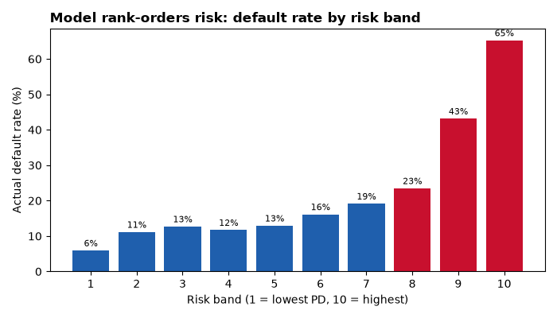
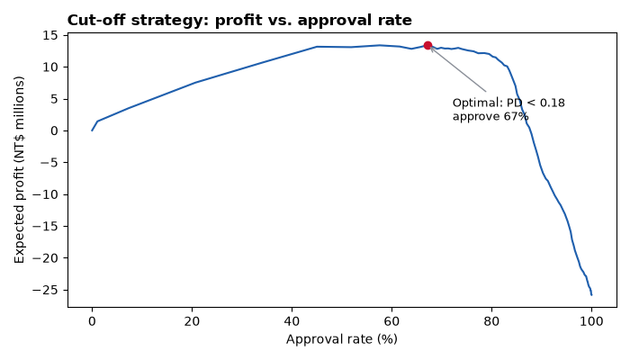

# Credit Risk Analysis & Default Prediction

**Which credit card clients will default next month, and what approval / credit-line strategy maximizes profit?**

End-to-end credit-risk project on 30,000 real credit card clients: SQL data cleaning and KPI reporting, client-behavior analysis, an explainable probability-of-default (PD) model, and a cut-off strategy that turns model output into a business decision with a dollar impact.

`SQL (SQLite)` · `Python (pandas, scikit-learn)` · `Power BI` · `Logistic Regression` · `AUC / Gini / KS`

---

## Key results

<!-- RESULTS:START -->
| | |
|---|---|
| Clients analyzed | **30,000** (portfolio default rate 22.1%) |
| PD model (logistic regression, hold-out test set) | **AUC 0.747 · Gini 0.494 · KS 0.385** |
| Challenger (gradient boosting) | AUC 0.778 (+0.031); logistic regression kept as champion for explainability, challenger monitored |
| Risk separation | Riskiest 10% of clients default at **65%** vs. **6%** for the safest 10% |
| Riskiest 30% of clients | hold **60%** of all defaults |
| Recommended cut-off | Approve clients with PD < **0.18** (67% of clients) |
| Bad rate after cut-off | **12.3%** vs. 22.1% approving everyone (63% of defaults avoided) |
| Expected profit uplift vs. approve-all | **NT$ 39.2M** on the test set |



<!-- RESULTS:END -->

---

## Business problem

A card issuer has to decide, every month, which clients keep full access to credit and which ones should be declined or have their credit line restricted. Being too strict loses good revenue; being too loose creates credit losses. This project answers:

1. **What does the portfolio look like?** Default rate, delinquency, utilization and trends (SQL KPIs).
2. **Which client behaviors come before a default?** Delinquency history, utilization, payment ratio.
3. **Can we predict default?** A PD model that is accurate *and* explainable to risk committees.
4. **Where should we draw the line?** The PD cut-off that maximizes expected profit.

## Data

[Default of Credit Card Clients](https://archive.ics.uci.edu/dataset/350/default+of+credit+card+clients) (UCI Machine Learning Repository): 30,000 clients of a Taiwanese card issuer, April to September 2005. It includes the credit limit, 6 months of repayment status, statement balances and payments, and whether the client defaulted the following month. Amounts are in New Taiwan dollars (NT$). See [`data/README.md`](data/README.md) for download steps.

## Approach

| Step | What | Where |
|---|---|---|
| 1. Load & clean | Load raw data into SQLite; recode undocumented values; engineer behavior features (utilization, max days past due, months delinquent, payment ratio); run data-quality checks | `sql/01_clean.sql`, `src/01_load_and_clean.py` |
| 2. KPIs | Portfolio summary, default rate by delinquency, utilization, limit, age, education, monthly trend and roll rates, exported to CSV for Power BI | `sql/02_kpis.sql`, `src/02_kpis.py` |
| 3. Behavior analysis | Charts showing which behaviors come before a default | `src/03_eda.py` |
| 4. PD model & strategy | Logistic regression (champion) vs. gradient boosting (challenger); AUC, Gini, KS; risk bands; profit-maximizing cut-off; fairness check | `src/04_model.py` |
| 5. Dashboard | Power BI report on the exported tables | `dashboard/` |

### Data-quality finding

In the raw repayment-status columns, the "1 month late" code appears almost only in the most recent month (September); in the earlier months, clients go straight from "paid" to "2 months late". A "1+ months late" delinquency trend would therefore show a fake jump in September. The monthly trend and roll rates use **60+ days past due (2+ months late)**, which is defined the same way in every month.

### Modeling choices

- **Logistic regression as the champion model.** In credit risk, models have to be explained to regulators, risk committees and auditors. Each coefficient translates into an odds ratio. A gradient-boosting challenger is trained to check that no meaningful accuracy is being left on the table.
- **Industry metrics.** Besides AUC, the model reports **Gini** (2·AUC − 1) and the **KS statistic**, the standard rank-ordering metrics in credit scoring.
- **Fair-lending by design.** Sex, marital status and age are **excluded from the model**. Sex is used only *after* scoring, to check that approval rates do not differ materially between groups.
- **Hold-out validation.** A stratified 70/30 train/test split; every reported metric is on unseen clients.

### Cut-off strategy assumptions

The expected profit of each PD cut-off is calculated on the test set:

- **Revenue:** good (non-defaulting) approved clients generate 15% of their balance per year (interest and fees).
- **Loss:** defaulting approved clients lose 80% of their balance (Loss Given Default = 80%).
- **Exposure:** the latest statement balance.

With these numbers, a client is only profitable when PD < 15% / (15% + 80%) ≈ **16%**. The assumptions are simplified on purpose and are set in `src/config.py`, so they are easy to change for a sensitivity analysis.

## How to run

```bash
pip install -r requirements.txt
# put UCI_Credit_Card.csv in data/ (see data/README.md)
python src/01_load_and_clean.py
python src/02_kpis.py
python src/03_eda.py
python src/04_model.py
python src/05_update_readme.py
```

All outputs (KPI tables, scored clients, charts) are written to `outputs/`.

## Repository structure

```
credit-risk-analysis/
├── data/                 raw data (not committed) + SQLite database
├── sql/
│   ├── 01_clean.sql      cleaning, feature engineering, data-quality checks
│   └── 02_kpis.sql       portfolio KPI queries
├── src/
│   ├── config.py         paths and business assumptions
│   ├── 01_load_and_clean.py
│   ├── 02_kpis.py
│   ├── 03_eda.py
│   ├── 04_model.py
│   └── 05_update_readme.py
├── outputs/              KPI CSVs, scored clients, model results, figures/
└── dashboard/            Power BI file and screenshot
```

## Limitations and next steps

- The data is from 2005 and from one market; the patterns, not the exact numbers, are what carry over.
- There is only one observation window, so the model cannot be checked for stability over time (PSI). That would be the first step with more recent data.
- Next: a points-based scorecard (WoE binning), probability calibration, and stress-testing the cut-off under different LGD and revenue assumptions.

---

**Author:** Miguel Gutierrez · [LinkedIn](https://linkedin.com/in/miguel-gutierrez-serrano-3b7b912ba) · [GitHub](https://github.com/MigueGs)
